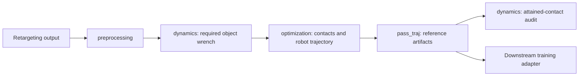

# Correction stages and entry points

The correction module starts from a retargeted reference. Direct dataset access
and SOMA decoding live at the repository root. All commands below run from that
root using the CPU environment described in [SETUP.md](../SETUP.md), except
`decode_tier1`, which uses the separate SOMA environment.

## File ownership

| Stage | Implementation | Responsibility |
|---|---|---|
| Preprocessing | `correction/src/preprocessing/reference.py` | Validate the geometric reference and build a sticking-phase bundle, using object inverse dynamics |
| Preprocessing | `correction/src/preprocessing/book_reference.py` | Read canonical human/object motion and the saved retargeted robot reference |
| Preprocessing | `correction/src/preprocessing/retarget_bridge.py` | Enable the pinned retargeting dependency and inspect inferred contacts |
| Dynamics | `correction/src/dynamics/models.py` | Rigid-body parameters and bounded contact-patch definitions |
| Dynamics | `correction/src/dynamics/object_wrench.py` | Pose smoothing, Newton–Euler wrench demand, coordinate transforms |
| Dynamics | `correction/src/dynamics/contact_audit.py` | Reallocate forces at attained robot contacts and report physical failures |
| Optimization | `correction/src/optimization/contact_optimizer.py` | Inner force QP, outer contact-placement optimization, dense validation |
| Optimization | `correction/src/optimization/book_wrench.py` | Book-specific assumptions and six-contact planning; returns arrays and report |
| Optimization | `correction/src/optimization/robot_trajectory.py` | Local arm/hand refinement; returns a `RobotCorrectionResult` |
| Output | `correction/src/pass_traj/phase_result.py` | Write generic corrected contact targets and force trajectories |
| Output | `correction/src/pass_traj/book_plan.py` | Write the intermediate wrench plan consumed by robot refinement |
| Output | `correction/src/pass_traj/robot_reference.py` | Write corrected robot NPZ/JSON and metrics using the retargeter's existing schema |

The `scripts/` directory parses command-line arguments and connects these stages.
Core optimization no longer writes the corrected robot reference itself. The
generic dynamics/contact optimizer does not require Torch, SOMA, or Pinocchio;
the book robot adapter and refinement use the existing robot runtime.

## Commands

Prefix each command with `python -m`:

| Module | Purpose |
|---|---|
| `correction.scripts.prepare_phase` | Read an explicit geometric reference and prepare a phase |
| `correction.scripts.run_phase` | Optimize and write a generic phase |
| `correction.scripts.inspect_reference` | Inspect contacts in canonical human/object motion |
| `correction.scripts.book_trial` | Plan and write book contact forces |
| `correction.scripts.repair_robot` | Refine and export the robot trajectory |
| `correction.scripts.audit_book` | Audit the saved result |
| `correction.scripts.book_pipeline` | Run book planning, refinement/export, and audit |
| `correction.scripts.demo` | Run the controlled synthetic pinch example |
| `correction.scripts.view_book` | Open the synchronized before/after viewer |
| `correction.scripts.plot_book` | Write a scientific figure; needs Matplotlib |

Use `--help` for arguments. Book commands accept `--directory`; planning and the
complete pipeline also accept `--start` and `--stop`. Defaults still select book
episode 11, frames 135–175. Making the interval configurable does not generalize
the book-face/contact assumptions to other tasks.

## Outputs and the training boundary

Generated filenames and schemas are preserved:

- `wrench_plan.npz` / `.json`: intermediate contact-force plan.
- `dynamics_guided.npz` / `.json`: corrected robot reference, in `v2d_retarget_v1`.
- `robot_repair_metrics.json`: kinematic diagnostics and optimizer settings.
- `fk_force_audit.npz` / `.json`: independent contact-force audit and invariants.
- `correction.npz` and `report.json`: generic geometric-phase results.

The downstream training workstream consumes the robot reference and adds scene
metadata, controller semantics, and its `motion_v1` training adapter. `pass_traj`
does not fabricate those missing pieces or mark the reference physically valid.
The existing book audit still reports `accepted_as_feasible_manipulation=false`.

## Migrating existing callers

| Previous import or command | Replacement |
|---|---|
| `correction.dynamics` | `correction.src.dynamics.object_wrench` |
| `correction.models` | `correction.src.dynamics.models` |
| `correction.optimizer` | `correction.src.optimization.contact_optimizer` |
| `correction.prepare_phase.prepare` | `correction.src.preprocessing.reference.prepare` |
| `correction.run_phase.save_result` | `correction.src.pass_traj.phase_result.save_result` |
| `correction.robot_repair.PatchTrackingTask` | `correction.src.optimization.robot_trajectory.PatchTrackingTask` |
| `python -m correction.robot_repair` | `python -m correction.scripts.repair_robot` |
| Other `python -m correction.<runner>` commands | `python -m correction.scripts.<runner>` |
| `correction/run.ps1` | `correction/scripts/run.ps1` |
| `python -m correction.fetch_sample` | `python -m fetch_sample` |
| `python -m correction.fetch_soma_assets` | `python -m fetch_soma_assets` |
| `python -m correction.decode_tier1` | `python -m decode_tier1` |
| `python -m correction.tier1_diagnostic` | `python -m tier1_diagnostic` |

Old flat module aliases are intentionally absent so there is one implementation
location per stage. Existing generated data stays in `correction/data/` and
`correction/outputs/`; this refactor does not move or regenerate user artifacts.
